<div align="center">

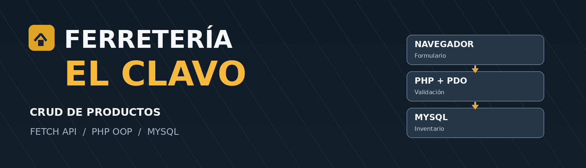

# Ferretería El Clavo

**Sistema de inventario con Fetch API, PHP orientado a objetos y MySQL**

`Guardar` · `Listar` · `Buscar` · `Editar` · `Validar`

**Universidad Tecnológica de Panamá · Desarrollo Web · II semestre de 2026**

</div>

---

## El proyecto

**Ferretería El Clavo** es una aplicación web de gestión de productos desarrollada como laboratorio de **CRUD con Fetch + PHP OOP + MySQL**. Permite registrar artículos, consultar el inventario, buscar por código o nombre y actualizar datos **sin recargar toda la página**. El sistema comunica JavaScript y PHP mediante `fetch()`, `FormData` y respuestas JSON.

| Integrantes | Cédula |
|:--|:--|
| **Ambar Greco** | 8-1011-480 |
| **Javier Vallarino** | 8-1040-1488 |

## Vista previa

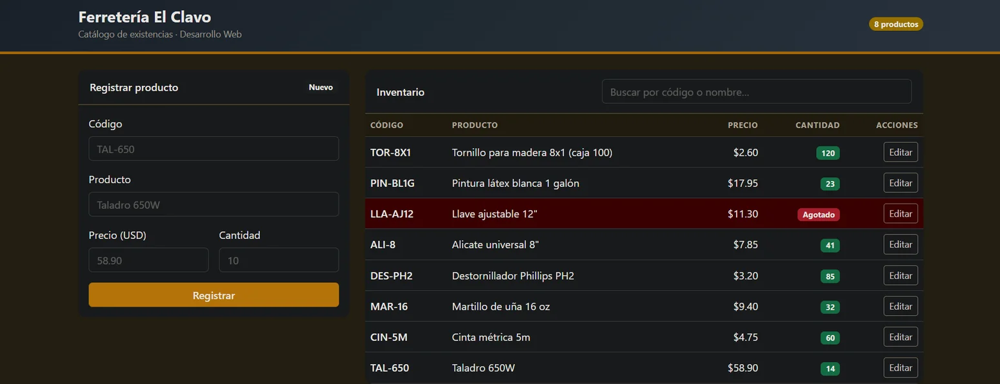

*Interfaz real del sistema: formulario de productos a la izquierda e inventario a la derecha. Captura tomada durante las pruebas locales.*

## Funcionalidades principales

| Función | ¿Qué permite hacer? |
|:--|:--|
| **Registrar** | Guardar código, nombre, precio y cantidad de un nuevo artículo. |
| **Listar** | Mostrar el inventario recuperado desde MySQL. |
| **Buscar** | Filtrar artículos por su código o nombre. |
| **Editar** | Cambiar los datos de un producto existente. |
| **Validar** | Evitar códigos repetidos, campos inválidos y existencias negativas. |
| **Notificar** | Mostrar mensajes de error, éxito y confirmación con SweetAlert2. |

> **Alcance del laboratorio:** el ejercicio implementa crear, consultar y actualizar. **La eliminación de productos no está implementada**; se contempla como posible ampliación.

## Evidencias del funcionamiento

### 01 · Registro de productos

El formulario recibe código, descripción, precio y cantidad. Al guardar, la tabla se actualiza para incluir el artículo registrado.

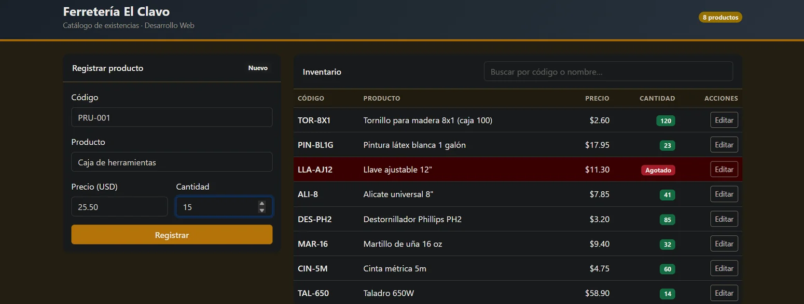

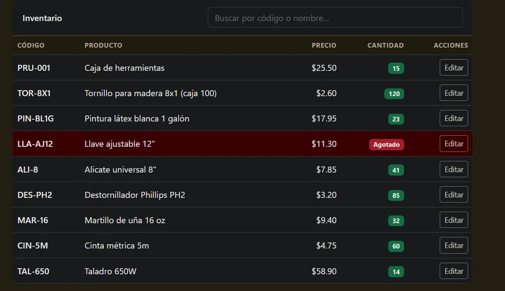

### 02 · Búsqueda dinámica

Al introducir `PRU-001`, la interfaz presenta únicamente el producto coincidente, sin recargar la página completa.

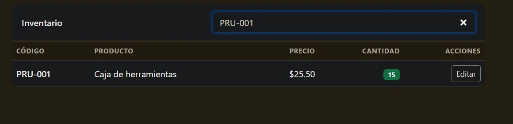

### 03 · Actualización de inventario

La opción **Editar** recupera los datos del artículo; el sistema solicita confirmación antes de modificarlo. En la prueba, el precio pasó de **$25.50 a $30.00** y la cantidad de **15 a 20**.

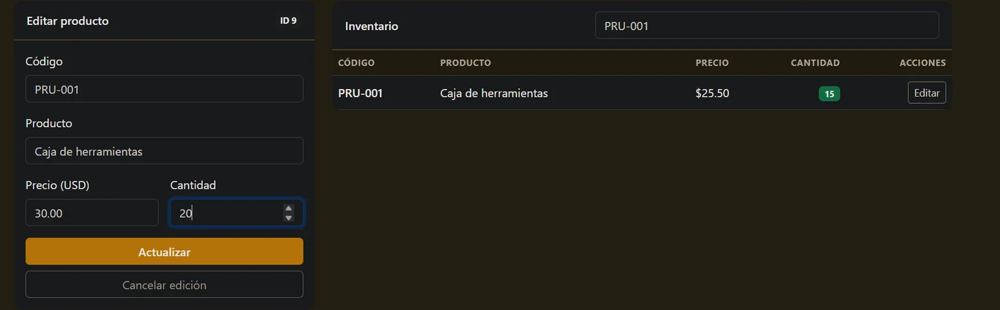

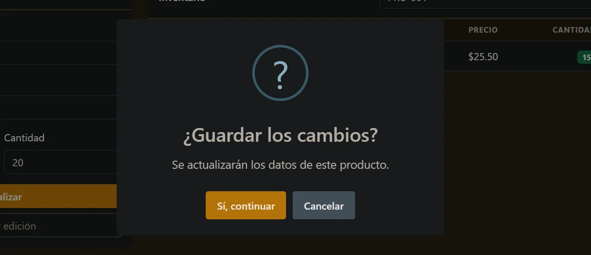

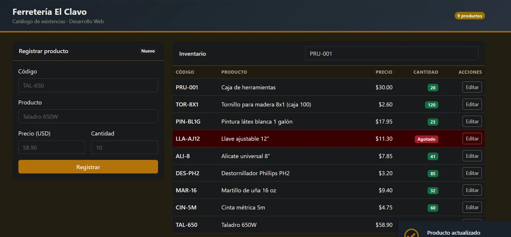

### 04 · Validación de códigos duplicados

La aplicación rechaza un segundo producto con el mismo código, indica qué campo debe corregirse y muestra una alerta descriptiva.

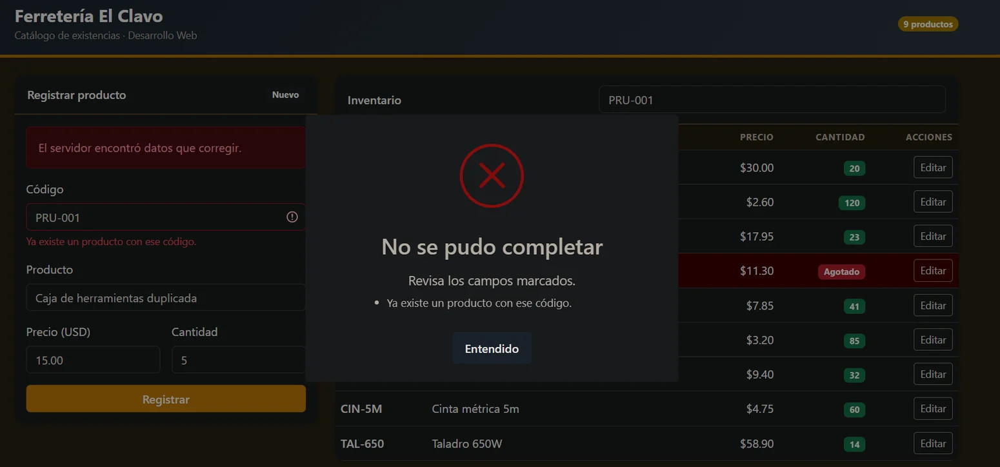

## ¿Cómo funciona?

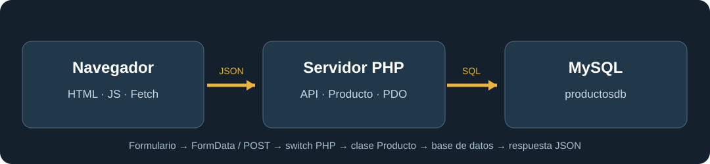

1. **HTML y Bootstrap:** muestran el formulario, buscador y tabla.
2. **JavaScript:** captura eventos y envía la solicitud con `fetch()` y `FormData`.
3. **`api/registrar.php`:** recibe `Accion` y utiliza `switch` para elegir la operación.
4. **`dominio/Producto.php`:** hidrata, valida y procesa los productos.
5. **`nucleo/conexion.php`:** gestiona la conexión PDO y las consultas preparadas contra MySQL.
6. **JSON + SweetAlert2:** el navegador interpreta el resultado, actualiza el contenido y muestra la notificación.

El archivo `public/js/script.js` también contiene un `switch` para interpretar `respuesta.accion`, conforme a los requisitos del laboratorio.

## Tecnologías utilizadas

| Capa | Herramientas |
|:--|:--|
| Interfaz | HTML5, CSS3 y Bootstrap 5 |
| Cliente | JavaScript, Fetch API y FormData |
| Alertas | SweetAlert2 |
| Servidor | PHP 8.1+ y programación orientada a objetos |
| Datos | MySQL / MariaDB y PDO |
| Entorno local | WampServer o XAMPP |

## Organización de los archivos

```text
crud-ferreteria-elclavo/
├── api/
│   └── registrar.php        # Endpoint y switch de acciones
├── dominio/
│   └── Producto.php         # Reglas de negocio y operaciones
├── nucleo/
│   ├── config.php           # Lee la configuración local
│   ├── conexion.php         # Conexión PDO
│   └── respuesta.php        # Respuestas JSON uniformes
├── public/
│   ├── css/estilo.css       # Diseño visual
│   └── js/script.js         # Fetch, eventos y SweetAlert2
├── sql/
│   ├── 01_esquema.sql       # Base de datos y tabla
│   ├── 02_usuario_app.sql   # Usuario de aplicación
│   ├── 03_ver_privilegios.sql
│   └── 04_datos_prueba.sql
├── vistas/
│   └── index.html           # Interfaz del catálogo
├── assets/                  # Imágenes del README
├── .env.example             # Plantilla de configuración
├── .gitignore
├── .htaccess
├── index.php
└── README.md
```

## Base de datos

Base de datos: **`productosdb`** · Tabla: **`productos`**

| Campo | Tipo de dato | Descripción |
|:--|:--|:--|
| `id` | `INT` | Clave primaria autoincremental |
| `codigo` | `VARCHAR(20)` | Código único del artículo |
| `producto` | `VARCHAR(100)` | Nombre del producto |
| `precio` | `DECIMAL(10,2)` | Precio unitario |
| `cantidad` | `INT` | Existencias |

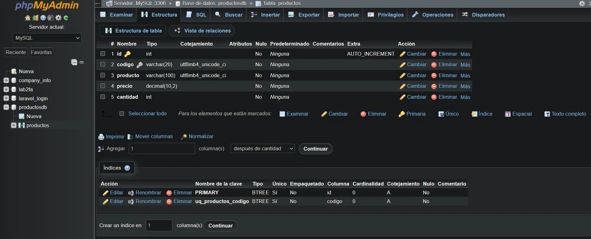

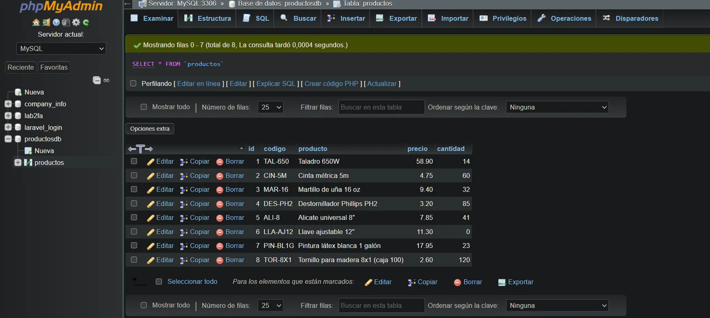

**Reglas de negocio:** al crear un producto se requieren al menos **1 unidad**; al editar se permite **0** para representar un producto agotado. Los códigos se normalizan a mayúsculas y deben ser únicos.

## Instalación local con WAMP o XAMPP

**Requisitos:** Apache, PHP 8.1 o superior, extensión `pdo_mysql`, MySQL/MariaDB y acceso a internet para las librerías cargadas por CDN.

**1.** Coloca el proyecto en la carpeta de tu servidor local:

- WAMP: `C:\wamp64\www\crud-ferreteria-elclavo`
- XAMPP: `C:\xampp\htdocs\crud-ferreteria-elclavo`

**2.** Enciende Apache y MySQL y abre phpMyAdmin. Importa estos scripts **en orden**, desde la pantalla principal del servidor MySQL:

```text
sql/01_esquema.sql       → Crea productosdb y la tabla productos
sql/02_usuario_app.sql   → Configura el usuario y sus privilegios
sql/04_datos_prueba.sql  → Inserta productos de ejemplo (opcional)
```

Puedes consultar los permisos con `sql/03_ver_privilegios.sql`.

**3.** Copia `.env.example` como `.env` y ajusta tus datos locales:

```dotenv
DB_HOST=127.0.0.1
DB_PORT=3306
DB_NAME=productosdb
DB_USER=tu_usuario_local
DB_PASS=tu_clave_local
```

**No publiques tu `.env` ni contraseñas reales en GitHub.** El archivo `.env.example` del código original incluye valores predeterminados de laboratorio; cámbialos si se reutilizan fuera del entorno local.

**4.** Abre en el navegador:

```text
http://localhost/crud-ferreteria-elclavo/
```

## Contrato de la API

Todas las operaciones se envían mediante `POST` a `api/registrar.php` con `FormData`. El campo `Accion` admite los siguientes valores:

| Acción | Propósito |
|:--|:--|
| `crear` / `guardar` | Registrar un artículo |
| `actualizar` / `modificar` | Editar un artículo |
| `listar` | Recuperar el inventario |
| `buscar` | Filtrar productos |
| `ping` | Comprobar la respuesta del endpoint |

Las respuestas tienen una estructura JSON consistente con `success`, `message`, `accion`, `errors` y `data`. Ejemplo **ilustrativo del formato**:

```json
{
  "success": true,
  "message": "Operación completada",
  "accion": "creado",
  "errors": {},
  "data": {}
}
```

## Validación y seguridad

- **Cliente y servidor:** verifican entradas y comunican errores por campo.
- **PDO y consultas preparadas:** reducen el riesgo de inyección SQL.
- **Código único:** restricción `UNIQUE` en MySQL para impedir duplicados.
- **Privilegios mínimos:** el usuario de la aplicación recibe permisos de lectura e inserción/actualización/eliminación de registros sobre `productosdb`, sin permisos administrativos sobre otras bases.
- **Salida JSON uniforme:** reduce errores al analizar respuestas del backend.

## Créditos

**Ambar Greco · Javier Vallarino**  
Universidad Tecnológica de Panamá · Desarrollo Web  
Docente: **Ing. Irina Fong** · Grupo: **1S3122**

Proyecto académico desarrollado para la guía **«CRUD – API Fetch y MySQL (Guardar, Editar, Buscar)»**.
